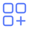

<!--
  Profile README for github.com/iamHarinda
  Visual system and editing guide: docs/README-DESIGN.md
  SVGs are generated — edit scripts/build-assets.mjs, then run: node scripts/build-assets.mjs
-->

<picture>
  <source media="(prefers-color-scheme: dark)" srcset="./assets/hero-dark.svg">
  
</picture>

 

### 01 · About

**I'm Harinda — a full-stack developer and digital product builder from Sri Lanka.**

I enjoy the whole arc of making software: understanding the problem, shaping the interface, and engineering the system underneath so it holds up in real use. Most of my work sits where engineering meets design — web applications, SaaS products, and small tools that do one job well.

I care about clear interfaces, maintainable code, and shipping work that is genuinely useful. Curiosity drives the rest.

 

### 02 · What I build

<table>
  <tr>
    <td width="50%" valign="top">
       
      <b>Modern web experiences</b> 
      Fast, accessible interfaces with Vue, Nuxt and Astro — designed with the same care they're engineered with.
    </td>
    <td width="50%" valign="top">
       
      <b>Full-stack applications</b> 
      End-to-end systems with Node.js, Express, PHP and Laravel: data models, APIs, and the interfaces on top.
    </td>
  </tr>
</table>

<!-- Two single-row tables: avoids GitHub's zebra striping on even rows. -->
<table>
  <tr>
    <td width="50%" valign="top">
       
      <b>SaaS &amp; digital products</b> 
      Taking ideas from first sketch to working product, balancing scope, quality and time to launch.
    </td>
    <td width="50%" valign="top">
       
      <b>Creative technology</b> 
      Experiments where code meets media and design — automation, content tooling and interactive ideas.
    </td>
  </tr>
</table>

 

### 03 · Stack

<table>
  <tr>
    <td valign="top"><b>Frontend</b></td>
    <td>Vue · Nuxt · TypeScript · JavaScript · Astro · HTML &amp; CSS</td>
  </tr>
  <tr>
    <td valign="top"><b>Backend</b></td>
    <td>Node.js · Express · PHP · Laravel · Python</td>
  </tr>
  <tr>
    <td valign="top"><b>Platforms &amp; tools</b></td>
    <td>Git · GitHub · Android (Kotlin) · Shopify (Liquid) · MDX</td>
  </tr>
  <tr>
    <td valign="top"><b>Creative workflow</b></td>
    <td>UI/UX design · Prototyping · Design systems · Media automation</td>
  </tr>
</table>

Tools I work with day to day — listed by area, not ranked by expertise.

 

### 04 · Selected work

Most of my product work lives in private repositories. Case studies and current projects are on **[iamharinda.com](https://iamharinda.com)**.

<!--
  Featured projects — uncomment and fill in when a project is public.
  Keep to three. One sentence on the problem, one on what you built.

<table>
  <tr>
    <td width="33%" valign="top">
      <b><a href="https://github.com/iamHarinda/REPO">Project name</a></b> 
      Nuxt · Laravel  
      What problem it solves, and what you built to solve it.
    </td>
    <td width="33%" valign="top">
      <b><a href="https://github.com/iamHarinda/REPO">Project name</a></b> 
      Vue · Node.js  
      What problem it solves, and what you built to solve it.
    </td>
    <td width="33%" valign="top">
      <b><a href="https://github.com/iamHarinda/REPO">Project name</a></b> 
      TypeScript  
      What problem it solves, and what you built to solve it.
    </td>
  </tr>
</table>
-->

 

### 05 · Connect

Always glad to talk about products, interfaces and interesting problems.

**[iamharinda.com](https://iamharinda.com)** &nbsp;·&nbsp; [X&nbsp;@iamHarinda](https://x.com/iamHarinda) &nbsp;·&nbsp; [beacons.ai/harinda](https://beacons.ai/harinda) &nbsp;·&nbsp; [GitHub&nbsp;@iamHarinda](https://github.com/iamHarinda)

 

<picture>
  <source media="(prefers-color-scheme: dark)" srcset="./assets/footer-dark.svg">
  
</picture>

Thinker · Challenger · Designer — Harinda Fernando, Sri Lanka

